# 📘 Manual Técnico y Guía de Instalación

---

## Instalación de QEMU/KVM

En el **host Linux** (máquina física):

```bash
sudo apt update && sudo apt install -y qemu-kvm libvirt-daemon-system libvirt-clients bridge-utils virt-manager
```

Verifica que KVM está habilitado:

```bash
kvm-ok
```

---

## Creación de Máquinas Virtuales

### Parámetros comunes:

- Disco: `10G`
- CPU: `2`
- Memoria: `3000 MB`
- Sistema: Ubuntu Server 22.04 (ISO)

Configuración de la Maquina Virtual

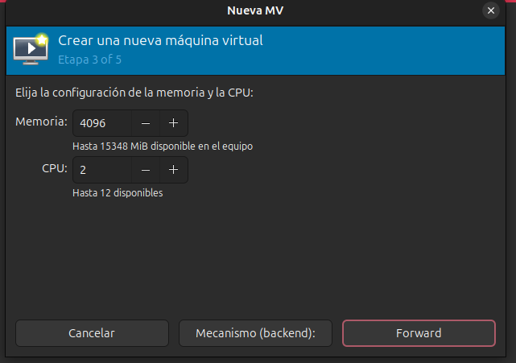

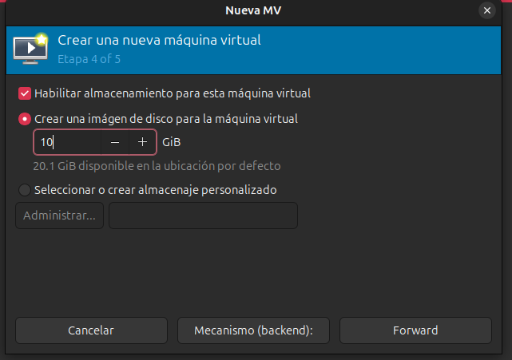

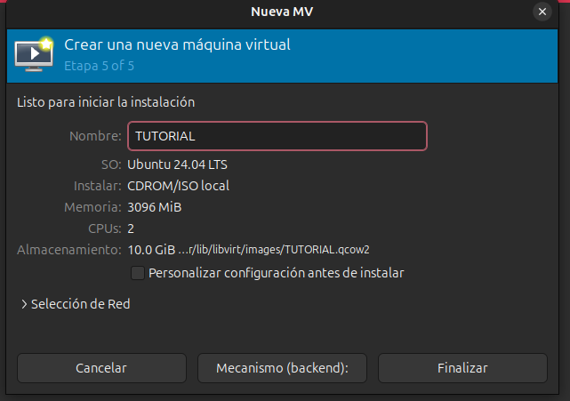

Instalación de Linux en las maquinas virtuales, ejemplo

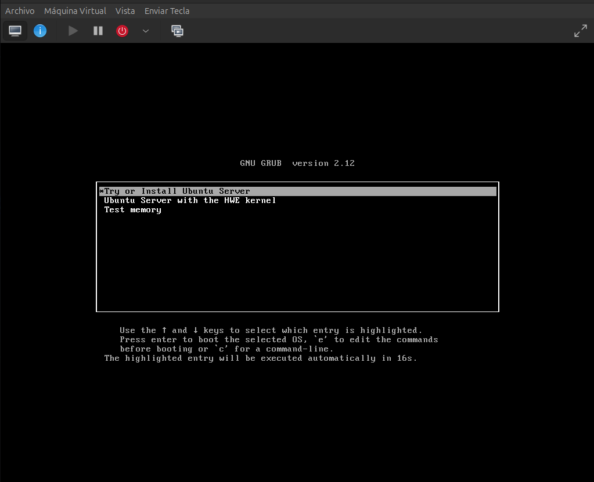

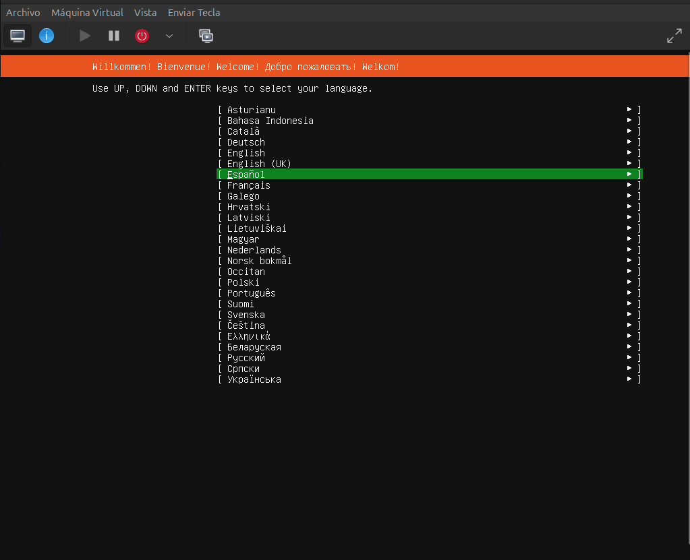

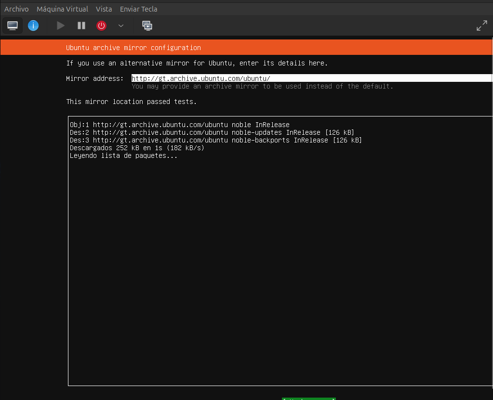

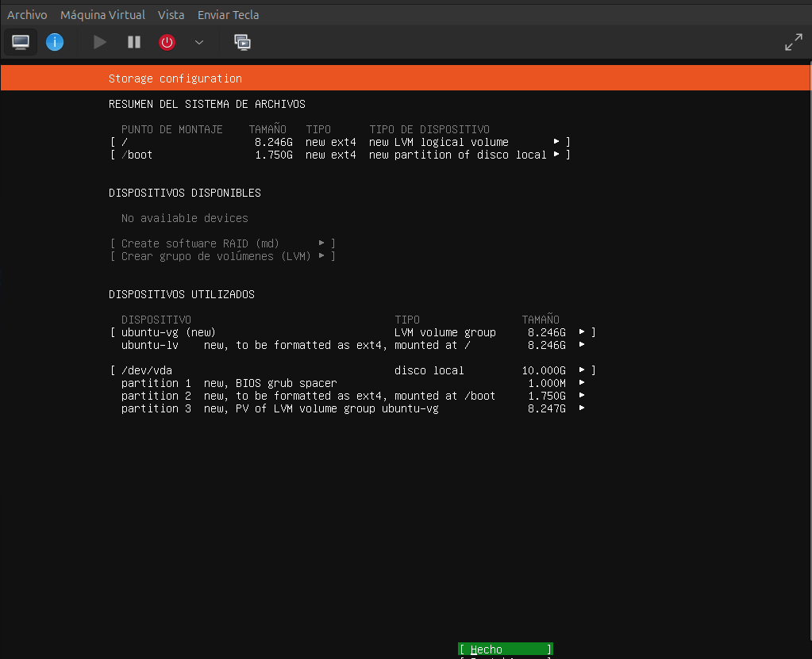

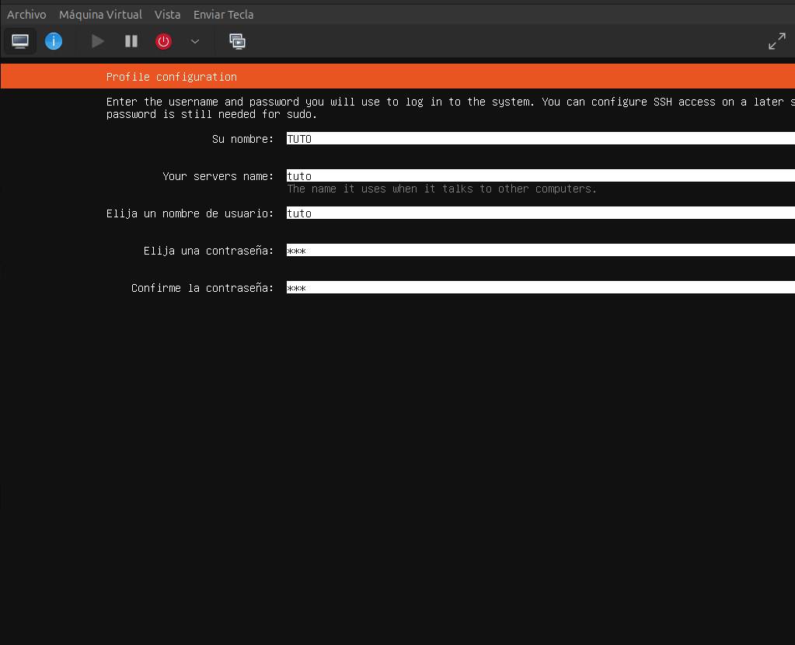

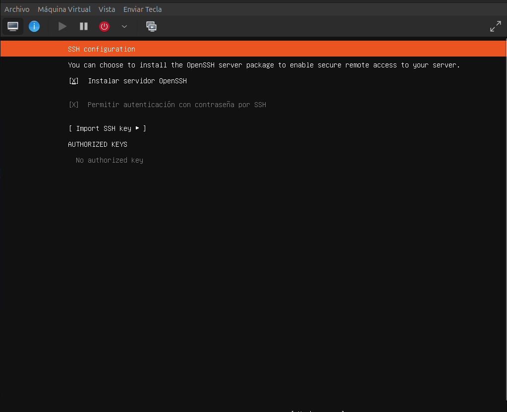

### VM1

Paso 1: Conectar VS Code con la VM1 por SSH

Paso 2: Instalar Go en VM1

En tu **VM1** (Ubuntu Server):

```bash
sudo apt update && sudo apt install -y golang-go
go version
```

Debe mostrar algo como `go version go1.22 linux/amd64`.

Paso 3: Crear proyecto de APIs

Dentro de VM1:

```bash
mkdir apis-vm1 && cd apis-vm1
mkdir api1 api2
```

### Código base para API1 (`api1/main.go`)

```go
package main

import (
    "encoding/json"
    "fmt"
    "net/http"
)

type Respuesta struct {
    Mensaje string `json:"mensaje"`
}

func llamarAPI2(w http.ResponseWriter, r *http.Request) {
    resp := Respuesta{
        Mensaje: "Hola, responde la API: API1 en la VM1, desarrollada por el estudiante Rdorigo con carnet: 202204496",
    }
    json.NewEncoder(w).Encode(resp)
}

func llamarAPI3(w http.ResponseWriter, r *http.Request) {
    resp := Respuesta{
        Mensaje: "Hola, responde la API: API1 en la VM1, desarrollada por el estudiante Rdorigo con carnet: 202204496",
    }
    json.NewEncoder(w).Encode(resp)
}

func main() {
    http.HandleFunc("/api1/202204496/llamar-api2", llamarAPI2)
    http.HandleFunc("/api1/202204496/llamar-api3", llamarAPI3)

    fmt.Println("API1 corriendo en puerto 8080...")
    http.ListenAndServe(":8080", nil)
}
```

### Código base para API2 (`api2/main.go`)

```go
package main

import (
    "encoding/json"
    "fmt"
    "net/http"
)

type Respuesta struct {
    Mensaje string `json:"mensaje"`
}

func llamarAPI1(w http.ResponseWriter, r *http.Request) {
    resp := Respuesta{
        Mensaje: "Hola, responde la API: API2 en la VM1, desarrollada por el estudiante Rdorigo con carnet: 202204496",
    }
    json.NewEncoder(w).Encode(resp)
}

func llamarAPI3(w http.ResponseWriter, r *http.Request) {
    resp := Respuesta{
        Mensaje: "Hola, responde la API: API2 en la VM1, desarrollada por el estudiante Rdorigo con carnet: 202204496",
    }
    json.NewEncoder(w).Encode(resp)
}

func main() {
    http.HandleFunc("/api2/202204496/llamar-api1", llamarAPI1)
    http.HandleFunc("/api2/202204496/llamar-api3", llamarAPI3)

    fmt.Println("API2 corriendo en puerto 8081...")
    http.ListenAndServe(":8081", nil)
}
```

Paso 4: Crear Dockerfiles

Dentro de cada carpeta (`api1` y `api2`), creá un `Dockerfile`:

### `api1/Dockerfile`

```docker
FROM golang:1.22
WORKDIR /app
COPY . .
RUN go build -o api1
CMD ["./api1"]
```

### `api2/Dockerfile`

```docker
FROM golang:1.22
WORKDIR /app
COPY . .
RUN go build -o api2
CMD ["./api2"]
```

## Instalación de `nerdctl` en Ubuntu (VM1)

Ejecuta estos pasos en **VM1**:

```bash
# 1. Instalar dependencias
sudo apt update
sudo apt install -y wget tar

# 2. Descargar nerdctl
wget https://github.com/containerd/nerdctl/releases/download/v1.7.7/nerdctl-1.7.7-linux-amd64.tar.gz

# 3. Descomprimir y mover a /usr/local/bin
tar Cxzvf /usr/local/bin nerdctl-1.7.7-linux-amd64.tar.gz

# 4. Verificar instalación
nerdctl --version
```

## Instalación de `containerd` en Ubuntu (VM1)

Ejecuta esto en tu VM1:

```bash
# 1. Instalar containerd desde los repositorios
sudo apt update
sudo apt install -y containerd

# 2. Crear configuración por defecto
sudo mkdir -p /etc/containerd
sudo containerd config default | sudo tee /etc/containerd/config.toml

# 3. Habilitar e iniciar el servicio
sudo systemctl enable --now containerd

# 4. Verificar que corre
systemctl status containerd
```

## Instalación de plugins CNI en Ubuntu

Corre estos pasos en la VM1:

```bash
# 1. Crear carpeta para los plugins
sudo mkdir -p /opt/cni/bin

# 2. Descargar versión estable de los plugins
wget https://github.com/containernetworking/plugins/releases/download/v1.4.1/cni-plugins-linux-amd64-v1.4.1.tgz

# 3. Extraer dentro de /opt/cni/bin
sudo tar -C /opt/cni/bin -xzf cni-plugins-linux-amd64-v1.4.1.tgz

# 4. Verificar que quedaron
ls -l /opt/cni/bin | head
```

## Instalar BuildKit (`buildctl` + `buildkitd`)

Ejecuta en la VM1:

```bash
# 1. Descargar BuildKit (última release estable)
wget https://github.com/moby/buildkit/releases/download/v0.13.2/buildkit-v0.13.2.linux-amd64.tar.gz

# 2. Extraer y mover binarios a /usr/local/bin
sudo tar -C /usr/local -xzf buildkit-v0.13.2.linux-amd64.tar.gz

# 3. Verificar instalación
buildctl --version
```

## Arrancar el BuildKit

BuildKit necesita un servicio (`buildkitd`) corriendo.

```bash
sudo nohup buildkitd > /var/log/buildkitd.log 2>&1 &
```

Para correrlo como servicio de `systemd`:

```bash
sudo tee /etc/systemd/system/buildkit.service <<EOF
[Unit]
Description=BuildKit
After=network.target

[Service]
ExecStart=/usr/local/bin/buildkitd
Restart=always

[Install]
WantedBy=multi-user.target
EOF

# Recargar y habilitar
sudo systemctl daemon-reload
sudo systemctl enable --now buildkit
```

Verificar:

```bash
systemctl status buildkit
```

En tu carpeta `~/apis-vm1/api1/` (donde está tu `main.go`), corre:

```bash
go mod init api1
go mod tidy
```

Construir imágenes:

```bash
cd api1
sudo nerdctl build -t api1-vm1:latest .
cd ../api2
sudo nerdctl build -t api2-vm1:latest .
```

Correr contenedores:

```bash
sudo nerdctl run -d --name api1 -p 8080:8080 api1-vm1:latest
sudo nerdctl run -d --name api2 -p 8081:8081 api2-vm1:latest
```

Verificar:

```bash
curl http://localhost:8080/api1/202204496/llamar-api2
curl http://localhost:8081/api2/202204496/llamar-api1
```

### VM2

## Instalaciones necesarias

### En **VM2 (containerd con API3)**

- `Conectar por SSH`
- `Instalar Go en VM2`
- `containerd`
- `Crear proyevto Apis` (viene junto a containerd para manejar contenedores)
- `nerdctl`
- `Crear Dockerfile`
- `Construir imagenes con nerdctl`

NOTA: Recuerda instalar lo necesario ya presentado en la primera maquina virtual

Ajustes para API3-VM2

```go
package main

import (
	"encoding/json"
	"fmt"
	"io"
	"net/http"
)

type Respuesta struct {
	Mensaje string `json:"mensaje"`
}

func llamarAPI1(w http.ResponseWriter, r *http.Request) {
	// Simula una llamada a API1 (ajusta la URL según la IP o nombre de VM1)
	resp, err := http.Get("http://api1:8080/api1/TU_CARNET")
	if err != nil {
		http.Error(w, "Error llamando a API1", http.StatusInternalServerError)
		return
	}
	defer resp.Body.Close()

	body, err := io.ReadAll(resp.Body)
	if err != nil {
		http.Error(w, "Error leyendo respuesta de API1", http.StatusInternalServerError)
		return
	}

	var api1Msg Respuesta
	json.Unmarshal(body, &api1Msg)

	// Respuesta de API3 con referencia a API1
	respAPI3 := Respuesta{
		Mensaje: "Hola, responde la API: API3 en la VM2, desarrollada por el estudiante TU_NOMBRE con carnet: TU_CARNET. Llamé a API1 y respondió: " + api1Msg.Mensaje,
	}
	json.NewEncoder(w).Encode(respAPI3)
}

func llamarAPI2(w http.ResponseWriter, r *http.Request) {
	// Simula una llamada a API2 (ajusta la URL según la IP o nombre de VM1)
	resp, err := http.Get("http://api2:8080/api2/TU_CARNET")
	if err != nil {
		http.Error(w, "Error llamando a API2", http.StatusInternalServerError)
		return
	}
	defer resp.Body.Close()

	body, err := io.ReadAll(resp.Body)
	if err != nil {
		http.Error(w, "Error leyendo respuesta de API2", http.StatusInternalServerError)
		return
	}

	var api2Msg Respuesta
	json.Unmarshal(body, &api2Msg)

	// Respuesta de API3 con referencia a API2
	respAPI3 := Respuesta{
		Mensaje: "Hola, responde la API: API3 en la VM2, desarrollada por el estudiante TU_NOMBRE con carnet: TU_CARNET. Llamé a API2 y respondió: " + api2Msg.Mensaje,
	}
	json.NewEncoder(w).Encode(respAPI3)
}

func main() {
	http.HandleFunc("/api3/TU_CARNET/llamar-api1", llamarAPI1)
	http.HandleFunc("/api3/TU_CARNET/llamar-api2", llamarAPI2)

	fmt.Println("API3 corriendo en puerto 8083...")
	http.ListenAndServe(":8083", nil)
}
```

Dockerfile para API3-VM2

```docker
FROM golang:1.22 as builder
WORKDIR /app
COPY . .
RUN go build -o api3 main.go

FROM scratch
COPY --from=builder /app/api3 /
EXPOSE 8083
CMD ["/api3"]
```

### VM3

## Instalar **Docker** en VM3

```bash
sudo apt update -y
sudo apt install -y ca-certificates curl gnupg lsb-release
sudo mkdir -p /etc/apt/keyrings

# Agregar llave GPG oficial de Docker
curl -fsSL https://download.docker.com/linux/ubuntu/gpg | sudo gpg --dearmor -o /etc/apt/keyrings/docker.gpg

# Agregar repo estable
echo \
  "deb [arch=$(dpkg --print-architecture) signed-by=/etc/apt/keyrings/docker.gpg] https://download.docker.com/linux/ubuntu \
  $(lsb_release -cs) stable" | sudo tee /etc/apt/sources.list.d/docker.list > /dev/null

sudo apt update -y
sudo apt install -y docker-ce docker-ce-cli containerd.io docker-buildx-plugin docker-compose-plugin

```

Verificar que Docker funcione:

```bash
sudo docker --version
sudo systemctl status docker
```

---

## Ejecutar **ZOT** con Docker

En Docker Hub ya existe la imagen oficial de ZOT → `ghcr.io/project-zot/zot`.

Vamos a correrla como contenedor.

```bash
sudo docker run -d --name zot \
  -p 5000:5000 \
  --restart=always \
  ghcr.io/project-zot/zot:latest
```

---

## Personalización del nombre de imagen `[API#-VM#]`

Si necesitas renombrar la imagen como piden, haces un **tag**:

```bash
sudo docker tag ghcr.io/project-zot/zot:latest zot-vm3:latest
```

Y luego puedes correrla desde tu nombre customizado:

```bash
sudo docker run -d --name zot \
  -p 5000:5000 \
  --restart=always \
  zot-vm3:latest
```

---

## Verificación

Verificar que el contenedor corre:

```bash
sudo docker ps
```

Deberías ver algo como:

```bash
CONTAINER ID   IMAGE          COMMAND   CREATED   STATUS   PORTS                    NAMES
xxxxx          zot-vm3:latest   ...      ...       Up       0.0.0.0:5000->5000/tcp   zot
```

Y puedes probar que responde:

```bash
curl http://localhost:5000/v2/_catalog
```

---

## Comunicación entre las VMs

- Desde **vm2** a **vm1**:

```bash
curl http://192.168.122.101:5001   # API1 en vm1
curl http://192.168.122.101:5002   # API2 en vm1

```

- Desde **vm1** a **vm2**:

```bash
curl http://192.168.122.102:5003   # API3 en vm2

```

- Desde cualquier VM a **Zot en vm3**:

```bash
curl http://192.168.122.103:5000/v2/_catalog

```

---

## Capturas de evidencia

Incluye:

**Creación de disco y virt-install** (pantallazo de terminal).

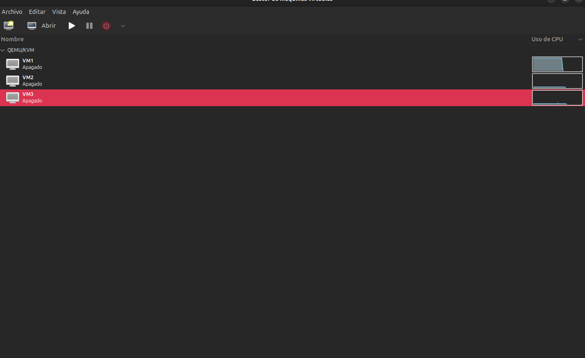

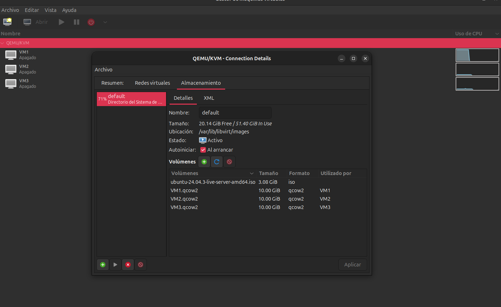

**Ejecución de APIs** (consola + curl desde otra VM).

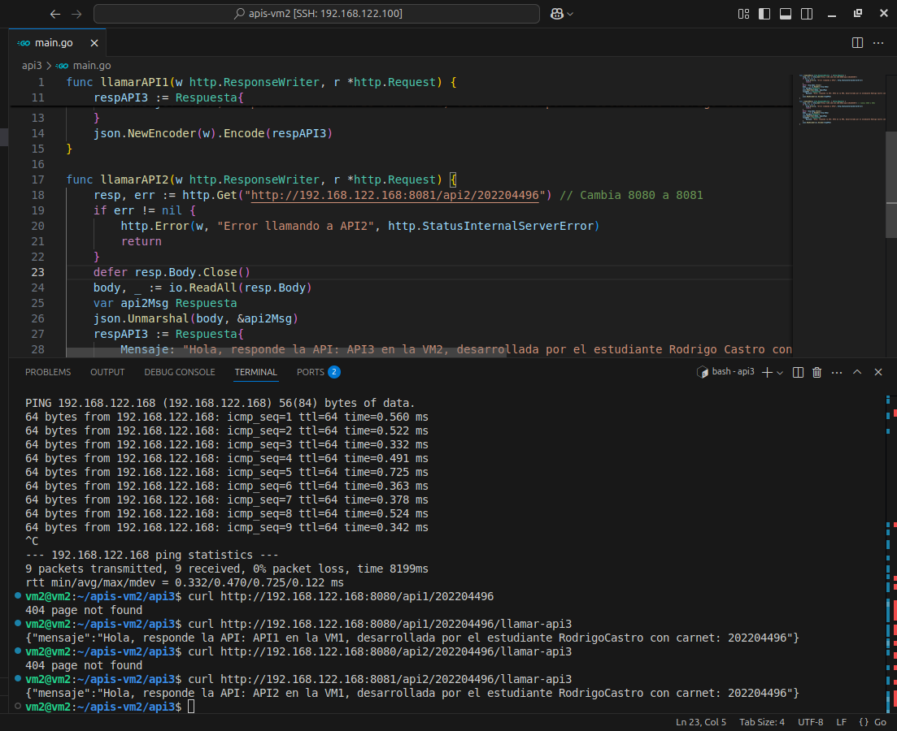

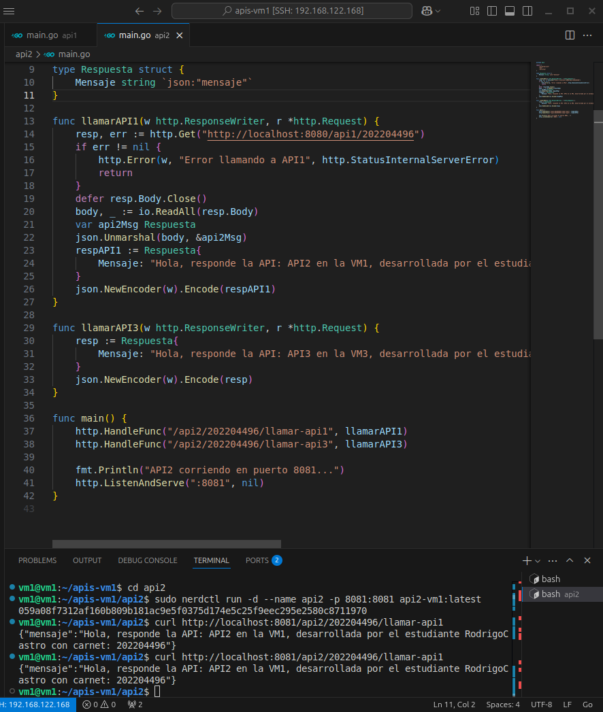

**Ejecución de Zot** (docker ps + curl al endpoint).

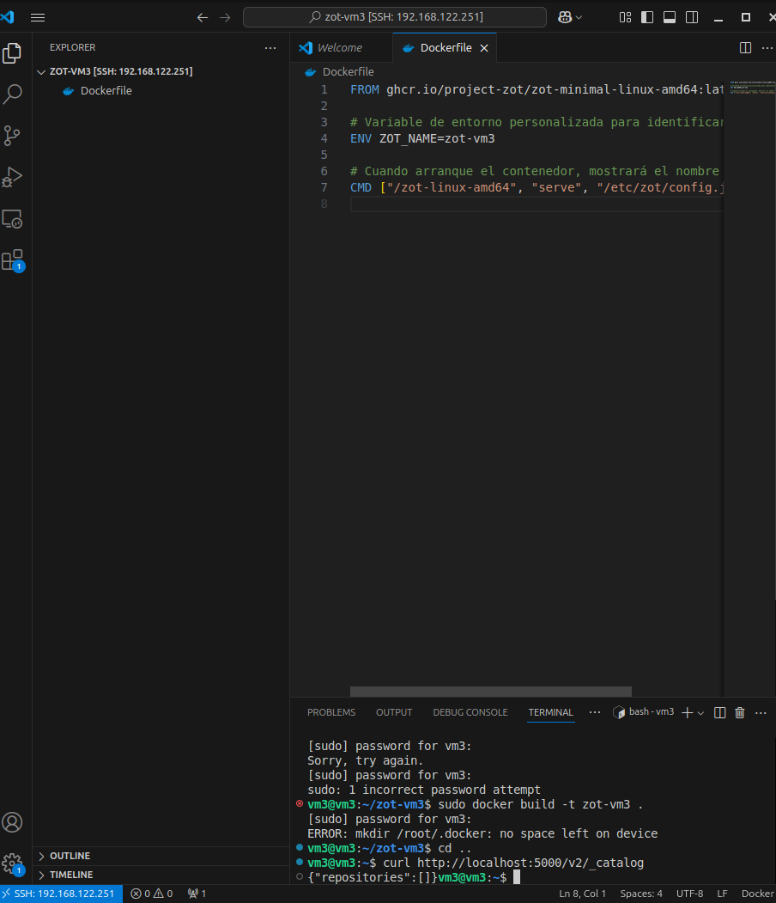

**Comunicación entre VMs** (curl de vm2 → vm1, vm1 → vm2).

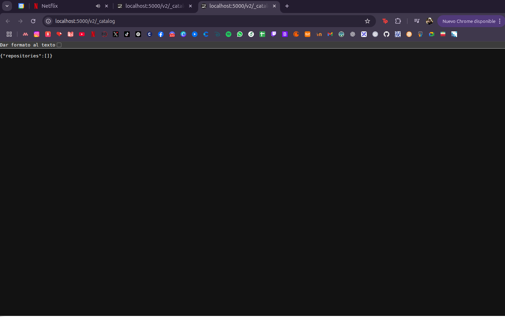